# Lumen Store

[](https://github.com/nodelorien/store-checkout/actions/workflows/ci.yml)

A small online store with a complete card checkout. You pick a product, pay with a credit card
through an external payment gateway (sandbox), give a delivery address and get the result of the
payment. Stock is updated when the payment is approved.

The project is a monorepo with a React single-page app, a NestJS API and the AWS infrastructure
that runs both.

- Live demo: <https://d1bup7lds8dkbd.cloudfront.net>
- API reference (Swagger): <https://d1bup7lds8dkbd.cloudfront.net/api/docs>

<p align="center">
  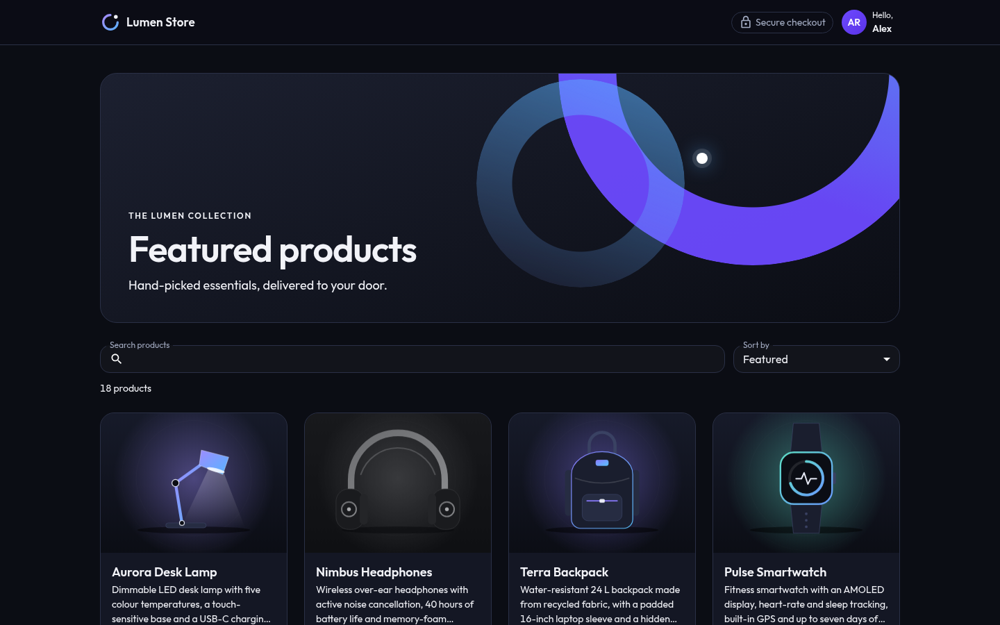
</p>

## Table of contents

- [Features](#features)
- [Screenshots](#screenshots)
- [Tech stack](#tech-stack)
- [Architecture](#architecture)
- [Getting started](#getting-started)
- [API](#api)
- [Caching](#caching)
- [Testing](#testing)
- [Load testing](#load-testing)
- [Deployment](#deployment)
- [Security](#security)
- [Project structure](#project-structure)
- [Known limitations](#known-limitations)
- [Documentation](#documentation)
- [AI-assisted development](#ai-assisted-development)

## Features

Store

- Catalogue of 18 products with search and sorting. Phones load more products as you scroll;
  wider screens get numbered pages.
- Card form with VISA and MasterCard detection, a live preview of the card and inline validation.
- Order summary with the product amount, base fee, delivery fee, total and instalments.
- Result page for approved, declined, failed and pending payments. Pending payments are polled
  until the gateway answers.
- Order tracking after an approved payment, with the option to correct the delivery address
  while the order is being prepared.
- "My orders" list kept on the device, and an Insights page with three reports: sales per day,
  top products and payment outcomes.
- Refreshing the browser at any step restores the checkout where it was.

API

- Prices and fees are always computed on the server.
- Payments are idempotent (`Idempotency-Key`), and a webhook endpoint accepts signed gateway events.
- Stock, the transaction and the delivery are written in one atomic DynamoDB transaction.
- Optional Redis cache for the heaviest reads.

## Screenshots

<p align="center">
  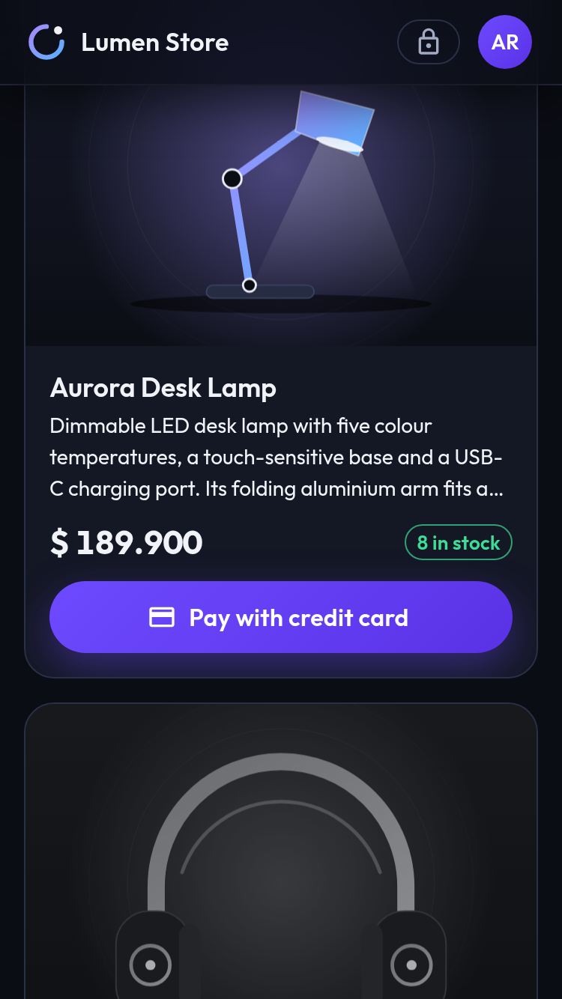
  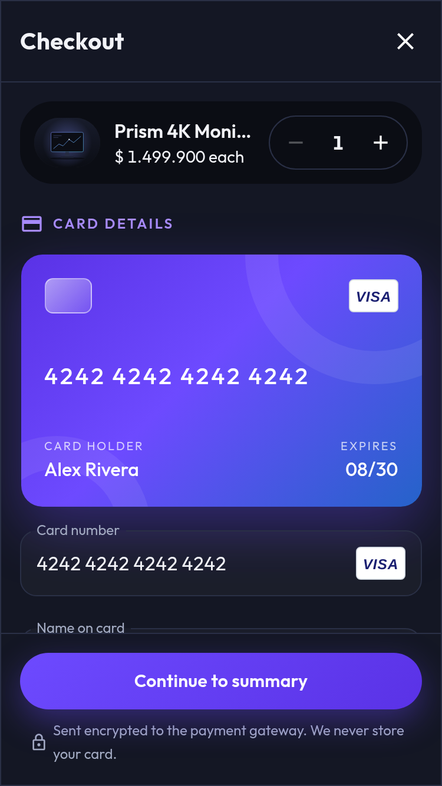
  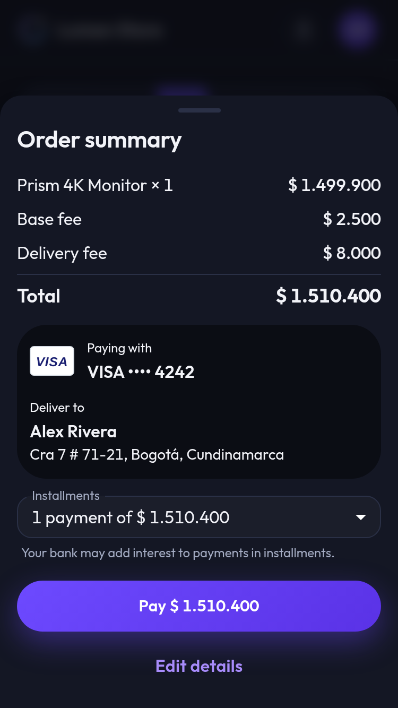
  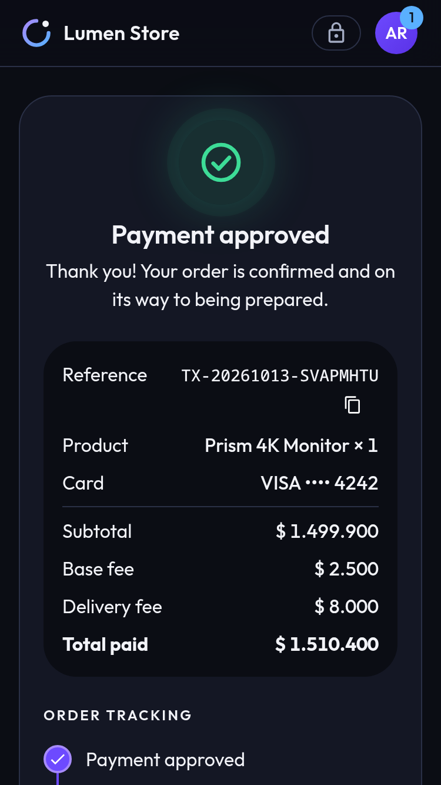
</p>

<p align="center">
  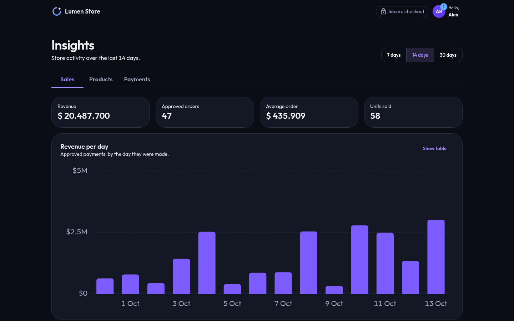
</p>

The screens are designed for a 375 px wide phone first. The data in the Insights screenshot is
sample data created locally.

## Tech stack

| Area | Tools |
|---|---|
| Web (`apps/web`) | React 19, TypeScript, Vite, MUI, Redux Toolkit and RTK Query, React Router, Zod |
| API (`apps/api`) | NestJS 11, TypeScript, AWS SDK v3, ioredis, Swagger |
| Data | DynamoDB (one table per aggregate), Redis (cache) |
| Infrastructure (`infra`) | AWS CDK: S3, CloudFront, API Gateway, Lambda, SSM Parameter Store |
| Tests | Jest, Testing Library, MSW, Supertest, k6 |
| CI/CD | GitHub Actions |

## Architecture

### System

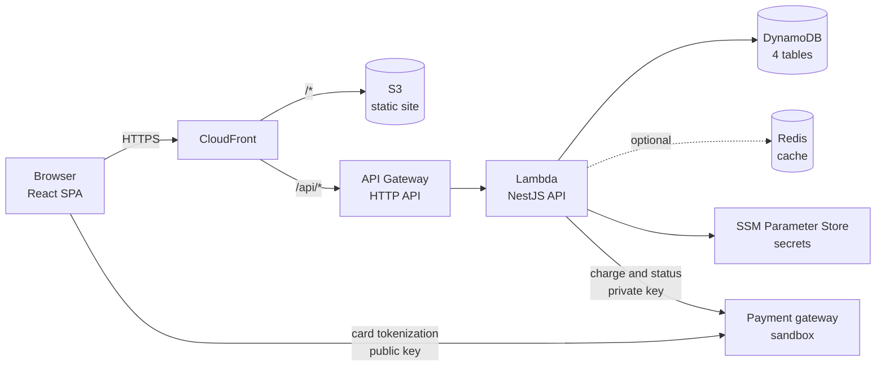

The site and the API share one CloudFront domain, so there is no CORS in production and the
security headers are set in a single place. The browser sends the card straight to the gateway
and receives a token; the API only ever sees that token.

### Backend

The API follows a hexagonal layout. Each module (`products`, `customers`, `transactions`,
`deliveries`, `payment-config`, `reports`) has the same three layers, and dependencies only point
inwards. An ESLint rule fails the build if the domain or the application layer imports NestJS
internals, the AWS SDK or anything from infrastructure.

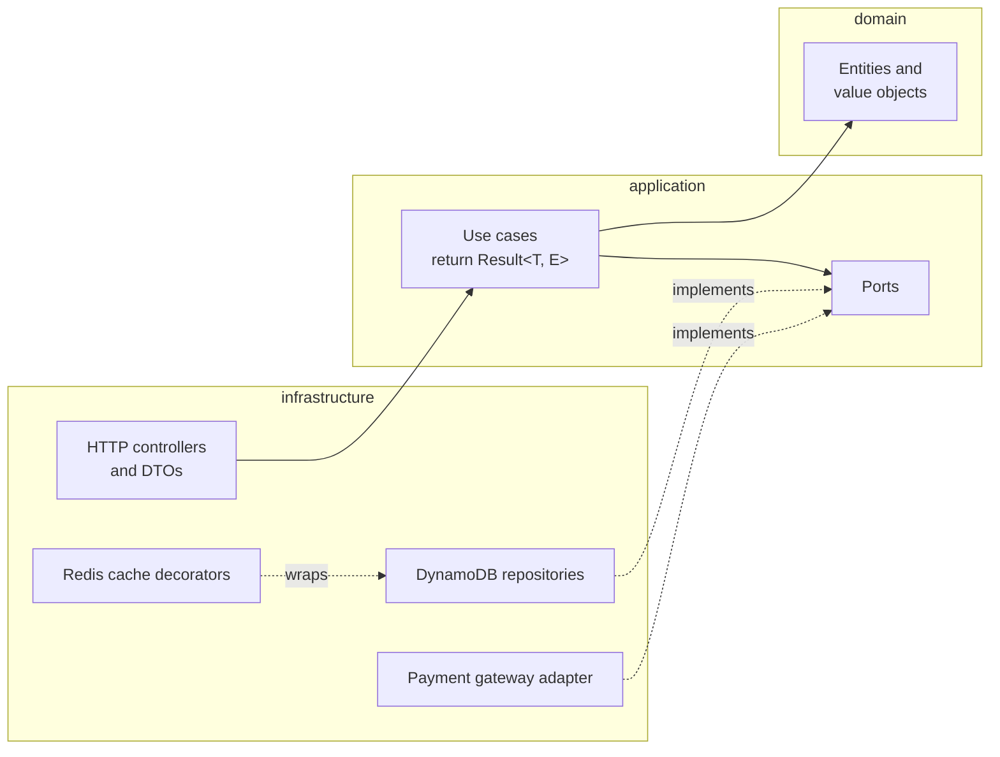

Use cases do not throw for expected failures. They return a `Result<T, E>` and chain steps with
`andThen`, so each one reads as a pipeline: validate, load, decide, write. Controllers only
translate between HTTP and a use case.

### Frontend

The web app keeps all state in Redux Toolkit. Server data goes through RTK Query; the checkout
itself is a slice with thunks and selectors, and components contain no business logic. A small
allow-listed snapshot of the checkout is saved to `localStorage` so a refresh can restore it.
Card number, CVC and expiry are never part of that snapshot. Code is organised by feature
(`products`, `checkout`, `transaction`, `account`, `insights`) with shared UI split into atoms,
molecules and templates.

### Payment flow

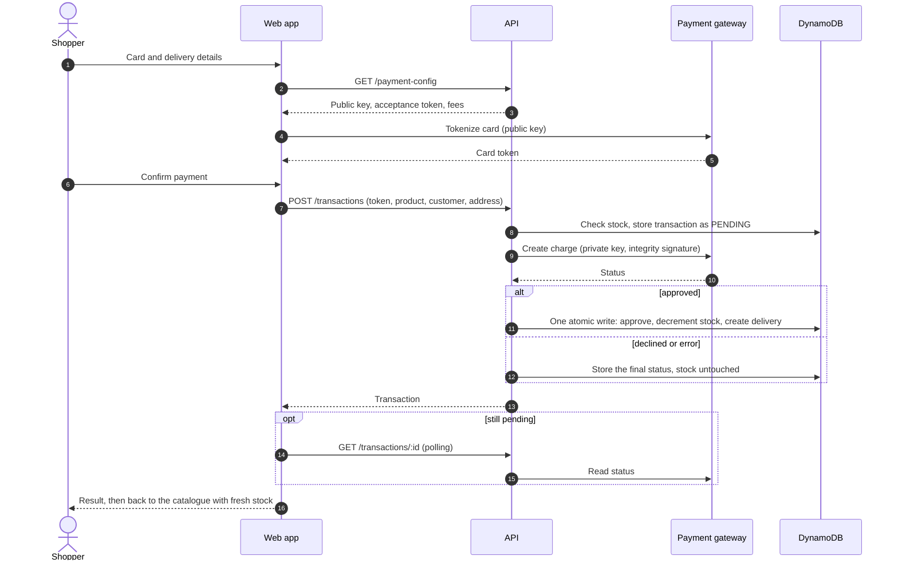

### Data model

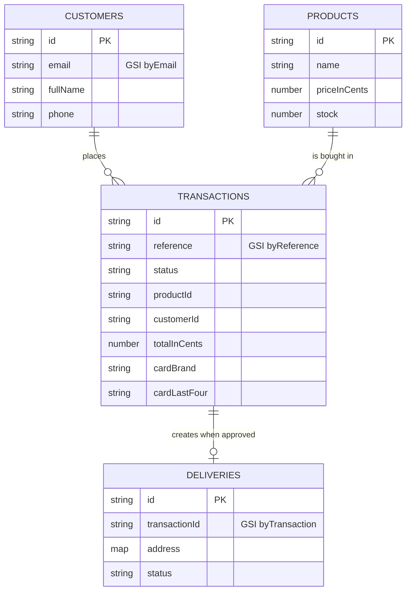

A transaction starts as `PENDING` and ends in one final status.

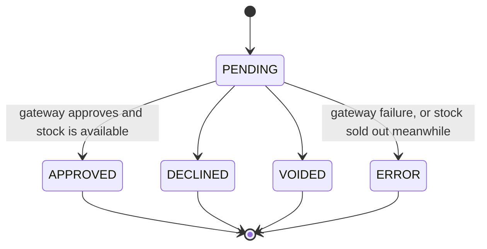

Money is stored as integer cents in COP. More detail in
[`docs/components/backend/data-model.md`](docs/components/backend/data-model.md).

## Getting started

Requirements: Node.js 22 or newer, npm and Docker.

```bash
git clone git@github.com:nodelorien/store-checkout.git
cd store-checkout
npm install

cp apps/api/.env.example apps/api/.env      # then fill in the gateway values
docker compose up -d dynamodb redis         # DynamoDB Local on :8000, Redis on :6379
npm run tables:create -w apps/api
npm run seed -w apps/api

npm run dev:api     # http://localhost:3000, Swagger at /api/docs
npm run dev:web     # http://localhost:5173
```

The gateway values in `.env` are the sandbox base URL and keys. They are not in the repository.

### Running without gateway credentials

The repository includes a local stand-in for the payment gateway. It is the same one the
integration and load tests use.

```bash
npm run gateway:stub -w apps/api    # listens on http://127.0.0.1:4010/v1
```

Then set `PAYMENT_GATEWAY_BASE_URL=http://127.0.0.1:4010/v1` in `apps/api/.env` and put any
non-empty text in the three key variables. Card `4242 4242 4242 4242` is approved and
`4111 1111 1111 1111` is declined, as in the sandbox. Any future expiry date and CVC work.

### Useful commands

| Command | What it does |
|---|---|
| `npm run lint` / `npm run format:check` / `npm run typecheck` | Static checks |
| `npm run test` | Unit tests of the three workspaces |
| `npm run test:cov` | Unit tests with coverage (fails under 80 %) |
| `npm run test:integration` | API integration tests (needs DynamoDB Local and Redis) |
| `npm run test:load -- browse` | Load test (needs Docker) |
| `npm run build` | Production build of web, API and infra |

## API

Base path `/api/v1`. Responses are JSON with a `data` field; errors share one envelope with a
`code`, a `message` and a `requestId`.

| Method | Path | Purpose |
|---|---|---|
| GET | `/health` | Liveness |
| GET | `/products` | Catalogue. Optional `page`, `pageSize`, `search`, `sort` |
| GET | `/products/:id` | One product |
| GET | `/products/:id/stock` | Current stock of a product |
| GET | `/payment-config` | Gateway public key, acceptance terms and fees |
| PUT | `/customers` | Create or update a customer by e-mail |
| GET | `/customers/:id` | One customer |
| POST | `/transactions` | Create a payment. Accepts `Idempotency-Key` |
| GET | `/transactions/:id` | Read a payment, reconciling with the gateway while pending |
| GET | `/transactions/:id/delivery` | Delivery of an approved payment |
| GET | `/deliveries/:id` | One delivery |
| PATCH | `/deliveries/:id` | Correct the address while the delivery is pending |
| POST | `/webhooks/payment-gateway` | Gateway events, verified by checksum |
| GET | `/reports/summary` | Sales, top products and payment outcomes. Optional `days` |

A declined card is not an HTTP error: the API answers `201` with `status: "DECLINED"`. The full
contract is in [`docs/components/backend/api.md`](docs/components/backend/api.md) and in Swagger.

## Caching

The catalogue and the sales report each read a whole DynamoDB table. Both are read much more
often than they change, so the API can keep them in Redis.

| Cached read | Lifetime | Invalidation |
|---|---|---|
| Full catalogue | 60 s | Deleted when an approved payment changes stock |
| Sales records of a date range | 30 s | None, it expires |

How it behaves:

- Search, sorting and paging run in memory over the cached catalogue, so every catalogue request
  shares one entry.
- A single product and its stock are never cached. The stock check before a charge always reads
  DynamoDB.
- The cache is optional. Without `REDIS_URL` the API works as before, and if Redis is down or
  slow a request falls back to DynamoDB instead of failing.
- Nothing personal is cached: products are public and sales records carry no customer or order ids.

The cache is added by wrapping the repositories behind their existing ports, so use cases did not
change. Locally it runs from `docker compose`. In AWS it is opt-in: the stack does not create a
Redis instance, because a private one would require a VPC and a NAT gateway. Instead, set the
deploy variable `REDIS_URL_PARAM` to the name of an SSM SecureString that holds a `rediss://` URL.
The reasoning is in [ADR-0013](docs/adr/0013-redis-cache-aside.md) and the details in
[`docs/components/backend/caching.md`](docs/components/backend/caching.md).

Settings: `REDIS_URL`, `CACHE_TTL_CATALOGUE_SECONDS`, `CACHE_TTL_REPORTS_SECONDS`.

## Testing

All tests use Jest.

### Unit tests and coverage

```bash
npm run test:cov
```

| Workspace | Suites | Tests | Statements | Branches | Functions | Lines |
|---|---|---|---|---|---|---|
| API (`apps/api`) | 44 | 643 | 99.94 % | 99.47 % | 99.80 % | 100 % |
| Web (`apps/web`) | 46 | 584 | 98.60 % | 94.51 % | 99.07 % | 99.40 % |
| Infra (`infra`) | 2 | 37 | 100 % | 100 % | 100 % | 100 % |

Each workspace fails below 80 % in any of the four measures, locally and in CI.

What they cover:

- API domain and use cases run against in-memory fakes of the ports, with one test per failure
  branch. Repositories are tested with a mocked AWS SDK client, controllers with Supertest
  through the real validation pipe, error filter and rate limiter.
- Web tests render components with Testing Library and a real Redux store. HTTP is intercepted
  with MSW, so thunks, RTK Query and the screens are tested together.
- Infra tests assert on the synthesized CloudFormation template: IAM scope, security headers,
  bucket privacy and environment variables.

### Integration tests

```bash
docker compose up -d dynamodb redis
npm run test:integration
```

These start the whole API and call it over HTTP. The database is DynamoDB Local, the cache is a
real Redis and the payment gateway is the local stand-in. Each run creates its own tables and
removes them at the end. There are 16 tests, and they cover what fakes cannot:

- An approved payment writes the transaction, the stock and the delivery together, and the
  gateway is charged once with the total computed by the server.
- Two shoppers paying for the last unit at the same time: exactly one is approved and stock ends
  at zero.
- A repeated `Idempotency-Key` produces a single charge.
- A declined payment, a gateway rejection and a gateway outage leave stock untouched.
- The catalogue is served from Redis, refreshed after an approval and kept after a decline.
- Redis entries expire, and an unreachable Redis is answered as a cache miss in under a second.

They run in CI as a separate job and are not counted in the coverage numbers above.

## Load testing

Load tests are [k6](https://k6.io) scripts in [`load-tests/`](load-tests). They send a fixed
number of requests per second, so a slow system shows up as latency and dropped requests rather
than as less traffic.

```bash
./load-tests/run.sh browse              # read traffic, cache on
CACHE=off ./load-tests/run.sh browse    # the same traffic without Redis
./load-tests/run.sh checkout            # complete purchases
```

The script builds the API, starts a throwaway local stack and runs k6 from its Docker image. The
gateway is always the local stand-in, with 150 ms of simulated latency. The tests are never run
against the gateway sandbox.

### Results

Measured on 2026-10-13 on one laptop (Ryzen AI 9 HX 370): a single Node process, DynamoDB Local,
Redis 7.4, 18 products and 2,509 stored transactions.

Read traffic: 60 s at 200 requests per second, a 20 s spike at 800, then 20 s back at 200. The
mix is 45 % catalogue pages, 15 % searches, 20 % product pages, 10 % stock and 10 % sales reports.

| | Without cache | With Redis |
|---|---|---|
| Requests answered | 30,613 | 38,650 |
| Requests dropped | 8,037 | 0 |
| Errors | 0 | 0 |
| p95, whole run | 5.27 s | 5.4 ms |
| p99, whole run | 10.34 s | 9.4 ms |
| p95 at 200 req/s | 79 ms | 4.1 ms |
| p95 during the spike | 9.53 s | 7.2 ms |
| p95 after the spike | 4.87 s | 3.4 ms |

Purchases: 45 s at 20 purchases per second and a 15 s spike at 60. That was 2,509 purchases and
10,037 requests with no errors.

| Request | p95 | p99 |
|---|---|---|
| Pay (`POST /transactions`) | 166 ms | 170 ms |
| Payment configuration | 153 ms | 154 ms |
| Read transaction | 2.2 ms | 3.1 ms |
| Catalogue after paying | 3.0 ms | 4.2 ms |

The first two include the 150 ms of simulated gateway latency, so the API itself adds roughly
10 to 15 ms to a payment.

What the numbers say:

- Without the cache, the sales report is the bottleneck. Every request scans the transactions
  table, and during the spike those scans queue up and slow down every other request on the same
  process. The backlog lasts beyond the spike.
- With Redis, the scan runs at most once every 30 seconds and the spike adds about 3 ms to p95.
- These are single-machine numbers against a database emulator. They show what saturates and
  what the cache removes, not the latency you would see in AWS.

Method, thresholds and limits are in
[`docs/architecture/performance.md`](docs/architecture/performance.md).

## Deployment

The CDK stack creates four DynamoDB tables, the Lambda function behind an HTTP API, a private S3
bucket and a CloudFront distribution with the security headers.

```bash
# Once: store the gateway secrets as SSM SecureString parameters
aws ssm put-parameter --type SecureString --name /checkout/prod/payment-gateway/private-key      --value '<private key>'
aws ssm put-parameter --type SecureString --name /checkout/prod/payment-gateway/integrity-secret --value '<integrity secret>'
aws ssm put-parameter --type SecureString --name /checkout/prod/payment-gateway/events-secret    --value '<events secret>'

export PAYMENT_GATEWAY_BASE_URL='<sandbox base url>' PAYMENT_GATEWAY_PUBLIC_KEY='<public key>'
npm run build
npm run bundle:api -w infra
npx cdk bootstrap --app "npx tsx infra/bin/app.ts"    # first time in an account and region
npm run deploy -w infra

# The seed reads apps/api/.env when it exists, so override the local values
AWS_REGION="$(aws configure get region)" DYNAMODB_ENDPOINT= TABLE_PRODUCTS=checkout-prod-products npm run seed -w apps/api
```

The stack deploys to the region of the active AWS profile. The live demo runs in `us-east-2`.

To enable the cache, store a Redis URL in a SecureString and export its name before deploying:

```bash
export REDIS_URL_PARAM=/checkout/prod/cache/redis-url
```

`.github/workflows/deploy.yml` runs the same steps on pushes to `main` once the repository
variables `AWS_DEPLOY_ROLE_ARN`, `PAYMENT_GATEWAY_BASE_URL` and `PAYMENT_GATEWAY_PUBLIC_KEY` exist.

## Security

- Card number, CVC and expiry never reach the API, the logs, Redux persistence or
  `localStorage`. The API rejects any request that contains a card field.
- Secrets live in `.env` locally (ignored by git) and in SSM Parameter Store in AWS.
- The Lambda role has no wildcard permissions: it can use its four tables and read its own
  parameters.
- Input is validated and unknown fields are rejected. There is a rate limit per client address,
  a 10 kB body limit, `helmet`, and `no-store` on every sensitive resource. Request logs are
  redacted.
- CloudFront sends HSTS, a Content-Security-Policy, `nosniff`, frame denial and referrer and
  permissions policies. The site scored A+ on Mozilla HTTP Observatory.

## Project structure

```
apps/
  api/                 NestJS API
    src/modules/       one folder per module: domain, application, infrastructure
    src/shared/        Result type, errors, config, DynamoDB client, cache
    test/              builders, fakes and integration tests
  web/                 React single-page app
    src/features/      products, checkout, transaction, account, insights
    src/shared/        API client, UI components, motion
infra/                 AWS CDK stack
load-tests/            k6 scripts and the script that runs them
docs/                  architecture, decision records, per-component guides
specs/                 one specification per feature
```

## Known limitations

- Stock is decremented when a payment is approved, not reserved beforehand. If two people pay for
  the last unit at once, both are charged and the second payment ends in `ERROR` and needs a
  refund.
- The catalogue is filtered and paged in memory. That is fine for hundreds of products, not for
  millions.
- The sales report scans the transactions table. It needs an index by day once the table grows.
- The rate limiter counts per Lambda instance.
- The user shown in the header is a fixed demo profile. There is no sign-in.

## Documentation

- [`docs/architecture/overview.md`](docs/architecture/overview.md): how the parts fit together
- [`docs/adr/`](docs/adr): why each significant decision was made
- [`docs/components/`](docs/components): guides for the API, the web app and the infrastructure
- [`docs/product/prd.md`](docs/product/prd.md): requirements
- [`specs/`](specs/README.md): the specification written before each feature
- [`AGENTS.md`](AGENTS.md): project rules and conventions for contributors

## AI-assisted development

This project was built with coding agents, and the repository carries the context they work
from. The same files are the documentation a person reads: there is no second, hidden set of
instructions. This section explains how that context is organised and how to work with it.

### Supported agents

Three command-line agents can work on the repository and they share one set of rules.

| Agent | Instructions it reads | Subagent definitions |
| --- | --- | --- |
| Claude Code | `CLAUDE.md`, which only imports `AGENTS.md` | `.claude/agents/*.md` |
| Codex | `AGENTS.md` | `.codex/agents/*.toml` |
| opencode | `AGENTS.md` | `.opencode/agents/*.md` |

Each tool has its own file format for subagents, so those files are kept deliberately thin: a
name, a scope and one line that says which skill to load. The knowledge lives in the skill, in
one place. `.claude/skills` is a symbolic link to `.agents/skills`, so no agent has its own copy.

### Context layers

A single large instructions file is read on every turn, costs tokens every time and goes stale.
The documentation is split into layers instead, and an agent loads the lowest layer that answers
its question.

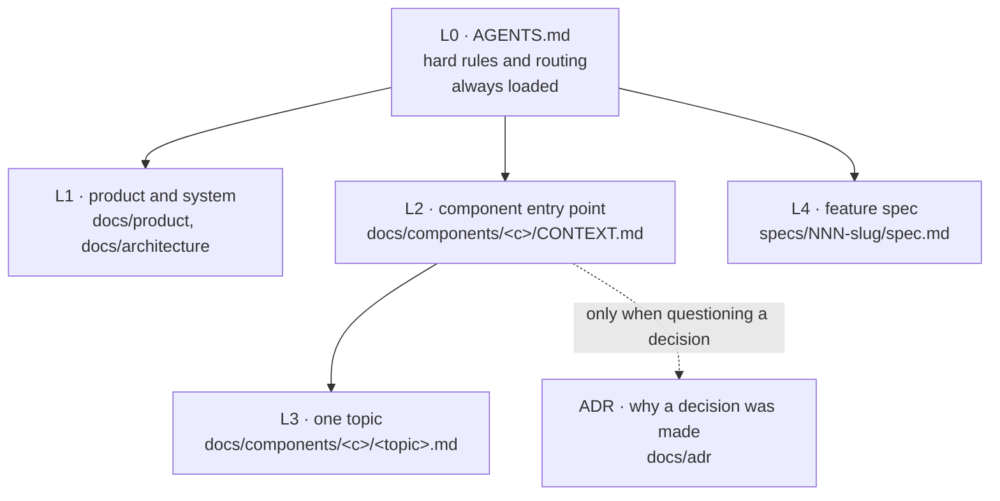

| Layer | What it holds | Where | Size cap | Loaded when |
| --- | --- | --- | --- | --- |
| L0 | Hard rules, the loading protocol, task routing | `AGENTS.md` | 80 lines | Always |
| L1 | Requirements and the shape of the system | `docs/product/prd.md`, `docs/architecture/` | none | Planning, work across components |
| L2 | The entry point of one component | `docs/components/<c>/CONTEXT.md` | 80 lines | Any work inside that component |
| L3 | One topic in depth (API contract, data model, state, caching…) | `docs/components/<c>/<topic>.md` | 150 lines | Only the topic being touched |
| L4 | One feature: scope and acceptance criteria | `specs/NNN-slug/` | 120 lines | Only the feature in progress |
| ADR | Why a decision was made | `docs/adr/` | 60 lines | Only to question or change a decision |

The rules that keep this working are short. Read L2 before L3. Do not load another component's
docs unless the task crosses the boundary; the contract between the API and the web app is
`docs/components/backend/api.md`. Never copy content between layers, link down instead. Change
the docs in the same pull request as the behaviour.

As an example, a task such as adding the Redis cache to the API needs `AGENTS.md`, the backend
`CONTEXT.md`, two L3 documents (caching and data model) and the feature's spec: about 400 lines.
The layered docs, decision records and specs together are close to 4,000.

Every L1 to L3 document starts with a small header that tells an agent whether the file is worth
reading:

```yaml
---
layer: L3
component: backend
read-when: touching the cache, its keys or lifetimes, or adding a cached read
---
```

### Skills and subagents

A skill is a Markdown file with the rules of one role: what to read first, how to work and what
to report. They follow the open Agent Skills format and live in [`.agents/skills/`](.agents/skills).

| Skill | Role | Subagent that loads it |
| --- | --- | --- |
| `sdd-workflow` | Write the spec, the plan and the task list of a feature | `spec-author` |
| `backend-dev` | API, domain, persistence and the gateway adapter | `backend-engineer` |
| `frontend-dev` | Pages, components, forms, Redux state and the checkout flow | `frontend-engineer` |
| `qa-testing` | Jest tests and the coverage gate | `qa-engineer` |
| `infra-deploy` | CDK stack, CI/CD and environment configuration | `devops-engineer` |
| `reviewer` | Read-only review of a diff against its spec, the architecture and security rules | `reviewer` |
| `ponytail`, `caveman` | Token savers, described [below](#token-savers) | every session |

`AGENTS.md` has a table that routes each kind of task to its skill and to the documents that
skill needs, so an agent does not have to explore the repository to find out where to start.

### Spec-driven workflow

No feature is written without a specification. Each one lives in [`specs/`](specs/README.md),
has its own branch (`feat/NNN-slug`) and its own pull request, and goes through the same steps:

1. `spec.md` says what the feature does from the outside and lists numbered acceptance criteria,
   including the failure paths.
2. A plan and an ordered task list follow, tests before implementation.
3. The implementation is reviewed against the spec, not against taste.

Requirements stay traceable from end to end: a requirement in the PRD (`FR-06`) is referenced by
a spec, the spec's criteria are numbered (`AC-3`), and the test that proves a criterion carries
that number in its name. The repository has 24 specs; the roadmap in `specs/README.md` lists them.

### Decision records

An ADR records why a decision was made and what was rejected. Agents do not read them to learn
what to do, only before proposing to change one. Accepted records are not edited: a new record
supersedes the old one, as 0011 did with 0006.

| # | Decision |
| --- | --- |
| [0001](docs/adr/0001-monorepo-layout.md) | Monorepo with `apps/api`, `apps/web` and `infra` |
| [0002](docs/adr/0002-hexagonal-backend.md) | Hexagonal architecture on NestJS |
| [0003](docs/adr/0003-railway-oriented-use-cases.md) | Railway-oriented use cases with an in-house `Result` type |
| [0004](docs/adr/0004-dynamodb-persistence.md) | DynamoDB as the database |
| [0005](docs/adr/0005-redux-toolkit-state.md) | Redux Toolkit with selective persistence |
| [0006](docs/adr/0006-stock-reservation.md) | Reserve stock while a payment is pending (superseded by 0011) |
| [0007](docs/adr/0007-client-side-card-tokenization.md) | Tokenize cards in the browser |
| [0008](docs/adr/0008-aws-serverless-deployment.md) | Serverless deployment on AWS with CDK |
| [0009](docs/adr/0009-jest-testing-strategy.md) | Jest everywhere, 80 % coverage enforced |
| [0010](docs/adr/0010-layered-ai-context.md) | Layered AI context and spec-driven development |
| [0011](docs/adr/0011-stock-update-on-approval.md) | Update stock only when the payment is approved |
| [0012](docs/adr/0012-atomic-layering-of-shared-ui.md) | Atomic layering of the shared UI |
| [0013](docs/adr/0013-redis-cache-aside.md) | Optional Redis cache-aside, fail-open |
| [0014](docs/adr/0014-token-saving-skills.md) | Token-saving skills for code and chat |

### Token savers

The layers limit what an agent reads. Two community skills limit what it writes, which is where
most of the cost of a session is. Both are copied into the repository unmodified, with their
licences, and `AGENTS.md` turns them on for every session.

| Skill | What it does | Source |
| --- | --- | --- |
| [`ponytail`](.agents/skills/ponytail/SKILL.md) | Takes the smallest change that fully solves the task: reuse what the codebase has, then the standard library, then an installed dependency, and only then new code. No abstractions or options nobody asked for. | [DietrichGebert/ponytail](https://github.com/DietrichGebert/ponytail) 5.2.0, MIT |
| [`caveman`](.agents/skills/caveman/SKILL.md) | Makes chat replies terse: the answer first, no greeting, recap or filler, with code, commands, paths and numbers kept exact. | [JuliusBrussee/caveman](https://github.com/JuliusBrussee/caveman) 3.2.0, Apache-2.0 |

Three limits apply here:

- The project's hard rules come first. A spec, a test for each acceptance criterion, the coverage
  gate and the docs are part of the task, not extras to be skipped.
- `caveman` applies to chat only. Code, comments, commit messages, documentation, specs and pull
  requests are written in full sentences, which is also what the skill itself prescribes.
- Only the two skill files are used. The proxies, hooks and installers of both projects are not
  part of this repository.

To turn one off for a session, tell the agent "stop ponytail", "stop caveman" or "normal mode".

The savings were not measured in this project. The authors publish their own figures: ponytail
reports about half the lines of code and 45 % fewer output tokens than the same agent without the
skill, and caveman cites a JetBrains study of 86 coding tasks that found 8.5 % fewer output tokens
with no measurable loss of quality. [ADR-0014](docs/adr/0014-token-saving-skills.md) has the
reasoning and the alternatives that were rejected.
